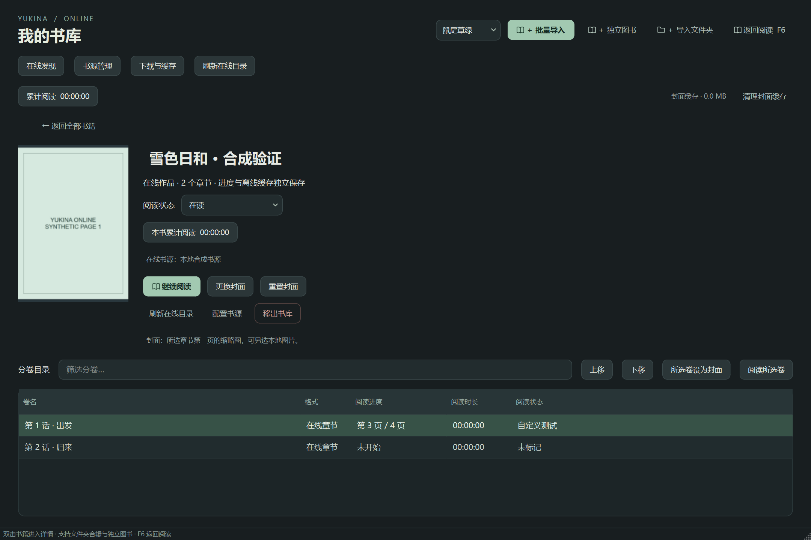

# yukina漫画阅读器 · 在线版

独立预览版本 **0.1.3-preview**。Windows、Android 和 Apple Silicon Mac 共用书源协议，各平台使用独立应用标识与书库。与原 yukina 本地阅读器并存。



## 可以做什么

- 默认配置漫画柜（中文）、MangaDex（中文，可另加日／英文）和 MangaPill（英文），无需自建服务器。另可连接开源 Komga、Suwayomi 服务或导入 Yukina JSON 目录。
- 搜索／翻页浏览作品，加入统一书库，刷新章节并保留已有阅读记录。
- 在线按需读取页面，页面仅留在内存；主动选择章节后下载到独立目录，下载完成后离线阅读。
- 自选下载目录。Windows 禁止将新下载缓存放入 C 盘；Android 使用系统文件夹授权，可选择 TF 卡内可写目录。更换下载目录后保留旧目录章节。
- 断点续下、页面 SHA-256 校验、损坏检测与重新下载。完整离线章节可在书源停用／移除后继续打开。
- 复用原阅读器的本地格式、日漫右到左、单双页、沉浸浮层、翻页效果、阅读状态、封面、进度、分卷／章节及阅读计时统计。
- 默认封面为章节第一页的缩略图，可改为另一个章节第一页或本地图片。移出书库只移除记录；删除缓存另有独立入口。

0.1.2 修复中文图片目录导致正文／封面加载失败的问题；升级后自动重试缺失封面，书库无需重新添加。详见 [修复验证](docs/UNICODE_URL_FIX_VALIDATION.json)。

0.1.3 默认启用流畅画质与后台预加载，增加低／原图选项，并在同次运行中复用已加载章节和页面。入口及网络／内存边界见 [在线性能说明](docs/ONLINE_PERFORMANCE.md)。

Mac 本机连接修正（build 20261026.2）：新增每书源独立的「跟随系统代理／直接连接」选项。MangaDex 中文与 MangaPill 英文已在本机打包应用加载真实正文；配置与范围见 [Mac 书源连接记录](docs/MAC_SOURCE_CONNECTION.md)。

Mac build 20261026.3 新增动漫屋中文书源并优先显示；已实测三部作品的搜索、章节和正文，不把 MangaDex 的书名元数据当作中文内容可用。具体范围见 [新增中文书源](docs/MAC_CHINESE_SOURCES.md)。

Mac build 20261026.4 调整为：单书详情下载、书库只管理已有缓存、阅读菜单调整画质、混合搜索已启用书源。见 [Mac 在线交互调整](docs/MAC_ONLINE_UI.md)。

## 首次使用

1. Windows 完整解压后运行 `YukinaOnline.exe`；Android 侧载独立 APK；Mac 在本机按下述步骤构建 `YukinaOnline.app`。
2. 打开「在线发现」，选择漫画柜、MangaDex 或 MangaPill 后搜索。首次升级会补齐缺少的内置来源，保留已有设置；之后手动移除的来源不会在每次启动时重新出现。可导入 `sources/common-presets.json` 恢复，MangaDex 其他语言见 `sources/mangadex-presets.json`。
3. 选择作品加入书库，在图书详情选择章节阅读。
4. 离线使用前，进入「下载与缓存」先选择下载路径，再选择章节下载。Android 每批最多 100 个章节，前台下载通知可显示进度；暂停后可继续上次队列。

Komga / Suwayomi 需要填写您可访问的服务器根地址及认证。Suwayomi 的扩展需先在服务端安装，然后使用「选择已安装扩展」将不同扩展保存为多个书源。**本程序不直接运行 Mihon APK、阅读／异次元脚本或任意网络代码**；不把这些不同格式的配置误认为通用兼容。

## 三端数据隔离

| 平台 | 应用／数据 | 下载缓存 |
|---|---|---|
| Windows 11 x64 | `YukinaOnline.exe`；同目录 `online-data` | 用户先选择的非 C 盘目录下 `yukina-online-downloads` |
| Android 8.0+ | 包名 `cn.yukina.online`，独立应用私有数据 | 系统授权目录下 `YukinaOnlineDownloads`，支持可写 TF 卡目录 |
| Apple Silicon Mac | `YukinaOnline.app`；`~/Applications/YukinaOnline/online-data` | 用户选择的目录下 `yukina-online-downloads` |

三个平台的书库、进度和下载不自动同步。本地书仍按原地址只读，不复制、不整包解压。本版默认不读取原阅读器的书库。Windows／Mac 开发时可通过 `YUKINA_ONLINE_DATA_ROOT` 指定另一独立数据目录。

## 开源书源与接口

Yukina 适配器代码按 AGPL-3.0-only 开源。漫画柜、MangaPill 的端点和选择器参考 Keiyoushi 开源适配器（Apache-2.0）；本项目自行实现固定解析，不执行网页脚本。Komga 是开源漫画服务器；Suwayomi 是开源扩展运行服务。MangaDex 使用公开 API，不宣称这些网站的服务器后端为开源。书源代码的开源许可不等于作品内容的许可。

接口和上游来源：[MangaDex API](https://api.mangadex.org/docs/)、[Komga](https://github.com/gotson/komga)、[Komga API](https://komga.org/docs/openapi/komga-api/)、[Suwayomi](https://github.com/Suwayomi/Suwayomi-Server)。具体数据格式和认证见 [书源配置说明](docs/SOURCES.md)。

## 从源码运行与构建

桌面端使用 Python 3.12（Mac 为原生 arm64）及 Qt / MuPDF。Windows 当前也验证 Python 3.10 环境。

```sh
python -m venv .venv
# Windows 使用 .venv/Scripts/python；Mac 使用 .venv/bin/python
python -m pip install -r desktop/requirements.txt
python -m pip install PyInstaller
python desktop/tools/prepare_archives.py
python desktop/app.py
# Windows 独立便携包
python tools/build_windows.py
# Mac 独立应用、arm64 与签名检查（只能在 Mac 执行）
python macos/build_macos.py
```

Android 在 Windows 上使用官方 SDK 34、JDK 21 和 Python 标准库。`android/tools/bootstrap.py` 下载构建工具；或用环境变量 `YUKINA_ANDROID_TOOLS` 指向已经准备好的工具目录。然后运行 `python android/tools/build.py`，结果位于 `android/dist/yukina-online-android-v0.1.3-preview.apk`。密钥不随源码分发；请保管在线版独立密钥，后续同签名才可覆盖在线版升级。

## 验证与当前边界

见 [验证记录](docs/VALIDATION.md)。当前 Windows 侧可执行开发、打包和界面验证；Mac 原生运行／打包需要在 Mac 完成。本机没有连接平板时，不将模拟器或静态检查写成真机通过。

在线来源可能变化、要求登录或限流。遇到认证失败、站点风控或不可用时显示错误，不绕过登录／付费／验证码。下载只在用户主动选择后开始；批量请求按顺序限速，不提供镜像破解。文字型 EPUB/MOBI、DRM、KF8/HuffDic 等原有格式边界仍存在。

本版本为独立预览；对已下载章节的完整性检查和模拟接口测试不等于所有真实书源兼容。首次使用建议先选少量章节验证。

## 许可证

AGPL-3.0-only；见 LICENSE、NOTICE.md 与 licenses。应用包中的第三方组件保留各自许可。Mac 本地 ad-hoc 签名不等于 Apple 公证。
